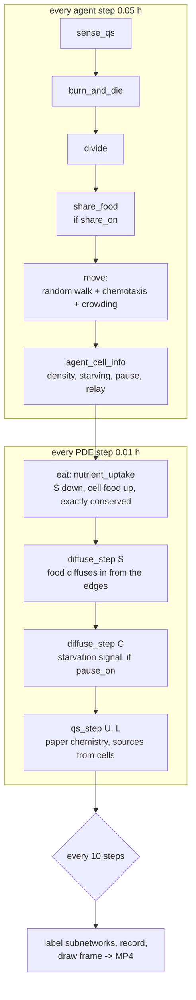
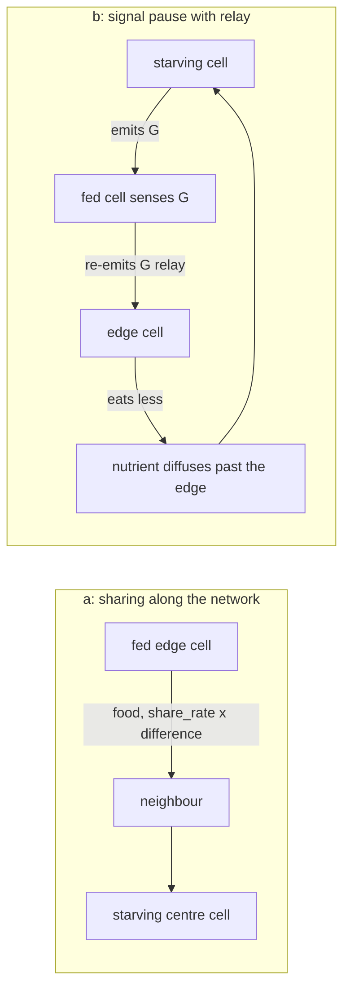

# emergence/: individual cells, nutrients, and QS, as video

This is a self-contained follow-on to `qs_model/`. Every **cell** (an agent standing for about 10³ bacteria) eats, stores food, divides, starves, moves and senses AHL on its own. The paper's AHL/lactonase chemistry runs underneath, solved by the same ADI/Thomas method. Each run renders a video **while it simulates**, with one frame every 0.1 h (every 10 PDE steps; use `--stride 1` for every step).

## How to run (from this folder)

```
python -m tests.test_emergence          # 8 unit tests, ~15 s
python run_stage0.py                    # paper model video + exact-match control, ~3 min
python run_stage1.py                    # four nutrient experiments + videos, ~10 min
python -m visualizations.make_figures   # comparison figures + 2x2 comparison video, ~1 min
```

Needs `numpy`, `matplotlib`, `imageio` and `imageio-ffmpeg`.

## Layout

```
emergence/
  qs_emergence/        the package (same comment style as qs_model: Input/Output/Steps/Types/Role)
    params.py          every number; STAGE1_RUNS = the four ON/OFF experiments
    grid.py            grid + agents<->grid bridge (cell_index, count_per_cell, sample, gradient)
    solver.py          Thomas + ADI, generalized to fixed non-zero edge values; qs_step (L->U->L)
    fields.py          QS sources from agents, nutrient uptake, pause factor, relay, signal source
    agents.py          seed, sense_qs, burn_and_die, divide, move (forage + crowding)
    network.py         share_food (hypothesis a), contact / supply-route subnetworks (union-find)
    engine.py          main loop with a frame callback
    video.py           MP4 writer + six-panel frame renderer
    paper_control.py   Stage 0: paper model, animated, checked against qs_model
  tests/               unit tests
  run_stage0.py, run_stage1.py
  videos/              stage0_paper_model.mp4, stage1_{neither,share,pause,both}.mp4
  results/             stage0_control.md, stage1_summary.md, stage1_*.npz
  visualizations/      make_figures.py, figures/ (PNG + s1_compare.mp4)
```

## What one time step does



## The two food-route hypotheses



## Stage 0: positive control

`results/stage0_control.md`: the new solver reproduces `qs_model` **exactly** (relative difference 0.0 at 5, 12 and 50 h, through the antibiotic dose). So any new behaviour in Stage 1 comes from the new biology, not from different numerics. `videos/stage0_paper_model.mp4` is figure 06 of the original project as a movie (500 frames).

## Stage 1: results (seed 0, 36 h)

See `results/stage1_summary.md` and the figures in `visualizations/figures/`.

| at 36 h | control | (a) share | (b) pause+relay | (a)+(b) |
|---|---|---|---|---|
| cells | 15,653 | 14,105 | **10,111** | 14,097 |
| starving cells | 955 | 876 | **0** | 877 |
| first starving cells appear | ~18 h | **~30 h** | ~18 h, then gone after ~22 h | ~30 h |
| nutrient at centre | 0.001 | 0.000 | **0.17** | 0.001 |
| contact subnetworks (islands) | 108 | **16** | 199 | 18 |

What each behaviour means, and how sure we can be of it:

1. **The starved centre emerges on its own (all runs).** Edge cells eat the nutrient before it diffuses inward. Nobody programmed "the centre starves"; it comes from uptake plus diffusion. In the control, the centre empties and the colony becomes a **ring**, fragmenting into ~100 islands.
2. **(a) Sharing delays starvation and holds the colony together.** There are no starving cells until ~30 h (vs ~18 h), and 16 islands instead of 108. The cost is **synchronised collapse**: food is spread so evenly that, when it runs out, many cells starve at once (0 → 876 cells within ~6 h). Sharing moves food around but adds none, so total supply still limits the colony.
3. **(b) A relayed starvation signal floods the colony and brings nutrient back to the centre.**
   - About 20 h in, the signal wave reaches the edge, edge cells pause, and nutrient diffuses back into the centre (green flood in `s1_kymographs.png`, row 3).
   - Starving cells disappear, but **growth stops for the whole colony** (cell count flat after ~22 h) and it scatters into ~200 islands. Survival is traded for growth.
   - This is a real emergent, colony-wide state switch, and **the relay is essential**. With passive diffusion only (`G_relay = 0`), the run matches the control: 1,015 starving cells and nutrient at the centre of 0.002 at 36 h. The signal reaches only ~22 µm from the starving zone.
4. **(a)+(b) behaves like (a) alone, an interaction between mechanisms.** Sharing keeps every cell above the starvation line, so no cell emits the signal and mechanism (b) never switches on. **One mechanism hides the trigger of the other.** It's worth testing on purpose (for example, a lower `share_rate`).
5. **The colony breaks symmetry.** Colonies grow elongated, and the direction depends on the random seed (seed 0 along x, seed 1 along y), so this isn't a grid artifact. A bulge that sticks out reaches more food, which is the nutrient-limited instability that also makes branches. *Not yet tested*: faster nutrient diffusion (`D_S`) should suppress it.

### Honest caveats

- **One seed per run.** The differences above are large, but ranges need several seeds before they become claims.
- **Exploratory values.** `D_S`, `V_max`, `K_S`, `share_rate`, `G_relay` and the motility constants are assumptions, chosen to place the model where nutrient limits growth (marked ASSUMPTION in `params.py`).
- **The early sawtooth in edge food (0–10 h)** happens because all 40 founders start with identical food and divide in lockstep. It's an artifact of the setup, not biology.
- **QS never switches on here either.** Max AHL ≈ 2·10⁻⁸ mol/L, below U_th = 7·10⁻⁸, as in the paper-parameter finding in `../claude-readme.md`. So these videos show nutrient-driven emergence; QS-driven emergence needs QS that can reach its threshold (sensitive strain, or `rho_ref` / density) and `qs_motility_on`.
- **No branching (dendrites) at these values.** The colony stays compact. Classic branching needs poorer nutrient and slower spreading, which is the next sweep.
