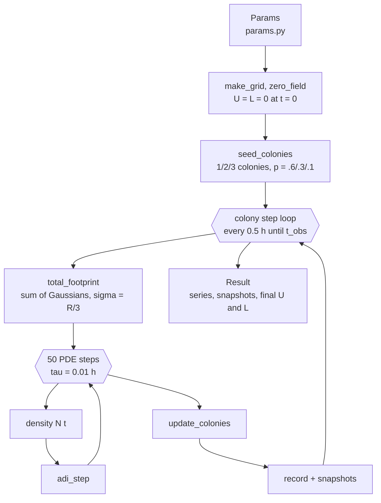
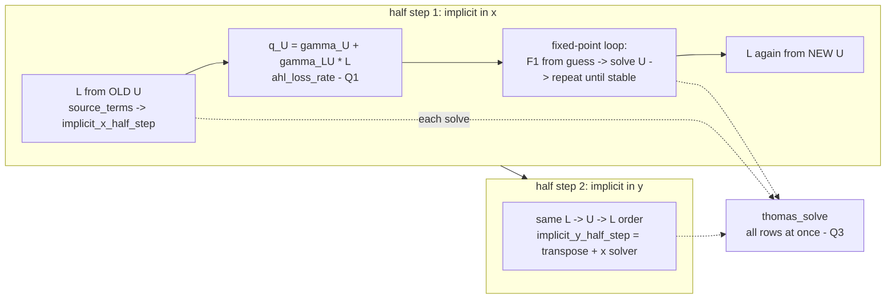
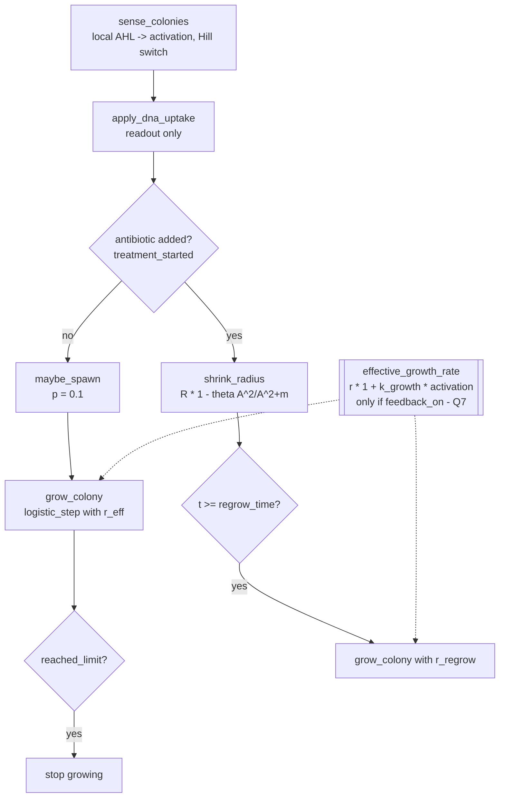
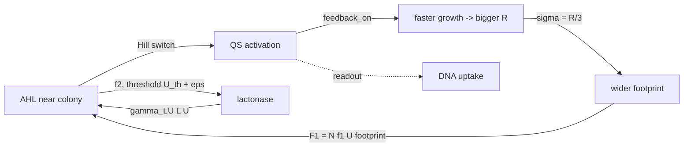

# Visualizations of the core logic

The diagrams below are drawn in Mermaid, so GitHub renders them. The PNG plots in `figures/` are produced by:

```
python -m visualizations.make_figures
```

---

## 1. The whole program: the paper's Figure 1 flowchart as function calls



## 2. Inside one PDE step: `adi_step` → `coupled_half_step` → `thomas_solve`



## 3. Colony update: the dashed box of the paper's flowchart



## 4. The Q7 feedback loop the paper does not have



In paper mode (`feedback_on = False`), the `ACT → R` arrow is cut. Bacteria still change the signal, but the signal never changes the bacteria.

---

## Figure index

| file | what it shows | step / quiz |
|---|---|---|
| `01_hill_switch_Q2.png` | f1 and f2 against AHL, and how eps delays the lactonase brake | production, **Q2** |
| `02_footprint_Q4.png` | Gaussian colony footprints: R sets where, N sets how much | production, **Q4** |
| `03_adi_vs_full_implicit_Q3.png` | Matrix shape for a fully implicit 2D step vs ADI chains | solver, **Q3** |
| `04_density_and_antibiotic.png` | N(t) and A(t) for one dose and three doses (paper Figs. 3, 5A, 8) | density, antibiotic |
| `05_colony_size.png` | Total colony radius over time (paper Figs. 5B, 9A) | colonies |
| `06_fields_snapshots.png` | AHL and lactonase maps at 5, 12 and 50 h (paper Fig. 6) | full model |
| `07_max_concentrations.png` | Max AHL and lactonase over time against the paper's values and U_th (Fig. 7) | full model |
| `08_half_lives_Q5.png` | Decay timescales: why lactonase collapses while AHL lingers | **Q5** |
| `09_positive_control_deterministic_Q6.png` | Deterministic control and the Fig. 4 perturbation test | **Q6** |
| `10_seed_variability_Q6.png` | Different seeds give different runs; paper values for reference | **Q6** |
| `11_coupling_Q1.png` | AHL with vs without lactonase destroying it | **Q1** |
| `12_feedback_Q7.png` | Feedback OFF vs ON, for the paper strain and the sensitive strain | **Q7** |
